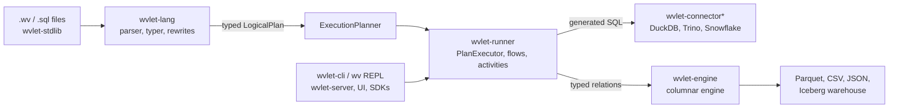

# Wvlet architecture

Wvlet is a flow-style query language. The compiler turns `.wv` files (and SQL) into typed logical plans, then either generates SQL for an external engine (DuckDB, Trino, Snowflake, Hive) or executes the plans directly on the in-process columnar engine. This page is the system map; area contracts live in [`design/`](design/README.md), and the reasons for individual decisions live in [`adr/`](adr/README.md).

## Read this first

- **New to the code:** read the module map and the three pipelines below, then the design page for your task.
- **Changing behavior:** update the owning design page in the same PR. Change this overview only when module boundaries, pipelines, or the reading map change.
- **Making a non-obvious decision:** add an ADR and link it from the owning design page. Plans in `plans/` describe proposed work, not the current system.

## System overview

## Module map

| Module | Platforms | Responsibility |
| --- | --- | --- |
| `wvlet-api` | JVM, JS, Native | Shared API types, `WvletLangException`, `StatusCode` |
| `wvlet-lang` | JVM, JS, Native | Compiler: parsers, typer, rewrites, SQL generation, LSP; native DuckDB loader |
| `wvlet-engine` | JVM, JS, Native | In-process columnar engine over uni's Parquet/Iceberg readers ([design](design/engine.md)) |
| `wvlet-connector`, `wvlet-connector-duckdb`, `wvlet-connector-snowflake` | JVM | Connector interface and registry, Trino/Slack, optional JDBC connector modules ([design](design/connectors.md)) |
| `wvlet-runner` | JVM, JS, Native | Executes compiled plans and `test` assertions; flows and activity items; the in-process `EmbeddedEngine` API ([embedding](design/embedding.md)) |
| `wvlet-cli`, `wvlet-cli-core` | JVM (+JS, Native core) | `wvlet` (`WvletMain`) and `wv` REPL (`WvletREPLMain`) commands |
| `wvc`, `wvc-lib` | Native | Standalone native compiler and the C library for C/C++/Rust bindings |
| `wvlet-server`, `wvlet-http-server`, `wvlet-client` | JVM (+JS, Native client) | HTTP API server and client |
| `wvlet-ui`, `wvlet-ui-main`, `wvlet-ui-playground` | JS | Scala.js + React web UI and the playground |
| `sdks/` | Node, Python, TS | npm CLI (`@wvlet/cli`), Python and TypeScript SDKs |
| `vscode-wvlet`, `prismjs-wvlet`, `highlightjs-wvlet`, `website` | JS | Editor extension, syntax highlighters, docs site |
| `wvlet-stdlib` | `.wv` | Standard function library ([design](design/stdlib.md)) |
| `spec/`, `wvlet-spec` | — | Spec-driven test cases and their runners ([design](design/testing.md)) |
| `formal/` | Lean 4 | Machine-checked models replayed by conformance tests ([design](design/formal-verification.md)) |

Build logic is in `build.sbt` (`projectJVM`, `projectJS`, `projectNative` aggregate each platform); sbt plugins are in `project/`.

## Compiler pipeline

`Compiler.allPhases` in `wvlet-lang` runs three groups over each compilation unit:

1. **Analysis:** `ParserPhase` (Wvlet or SQL → untyped `LogicalPlan`), `PreprocessLocalExpr`, `SymbolLabeler` (symbols for named entities), `RemoveUnusedQueries`, `Typer` (bottom-up typing with `TyperRules` and `TypeInference`), `SQLValidator`, `ModelDependencyAnalyzer`.
2. **Transform:** `RewriteExpr` and engine-specific rewrites (`TrinoRewritePivot`, `HiveRewriteFunctions`, `HiveRewriteUnnest`), plus `Incrementalize` for subscriptions.
3. **Code generation:** `ExecutionPlanner` and `ExecutionPlanRewriter` produce the execution plan; `SqlGenerator` folds plan nodes into SELECT blocks per `DBType` dialect.

Name lookup, coercion, operator typing, SELECT folding, and rewrites have Lean models; see [formal verification](design/formal-verification.md).

## Engine pipeline

`wvlet-engine` executes typed relations, not SQL. `RuntimeBinder` binds a relation into the runtime IR (`RuntimePlan`, with column ids), `Optimizer` runs named logical passes over it, and `Lowering` builds physical operators (`exec`) that run morsel-parallel over columnar batches (`vector`). Stdlib `sql"..."` templates are parsed back into engine expressions. DuckDB is the conformance oracle. See [the engine page](design/engine.md).

## Runner

`wvlet-runner` drives a compiled plan: it evaluates each statement through a connector (generated SQL) or a `WvletEngineSession` (the default when no target is given), prints results, and checks `test` assertions. It also runs `wvlet build` models as flows and the activity item state machine (`ItemStore`, `TaskQueue`, `BatchExecutor`).

## Reading map

| Working on | Read |
| --- | --- |
| Lean models, conformance fixtures | [Formal verification](design/formal-verification.md) |
| Engine planner, operators, optimizer toggles, golden plans, benchmarks | [Engine](design/engine.md) |
| Stdlib functions and per-engine catalogs | [Stdlib](design/stdlib.md) |
| Spec files, CI ratchets, test pitfalls | [Testing](design/testing.md) |
| Scala.js / Scala Native code, native builds, libduckdb | [Platforms](design/platforms.md) |
| Database connectors | [Connectors](design/connectors.md) |
| Versioning, tags, VS Code extension publishing | [Releasing](design/releasing.md) |
| Syntax or CLI changes that agents must learn | [Agent docs](design/agent-docs.md) |
| Typer and compiler internals for contributors | [Compiler internals](website/docs/development/compiler-internals.md) |
