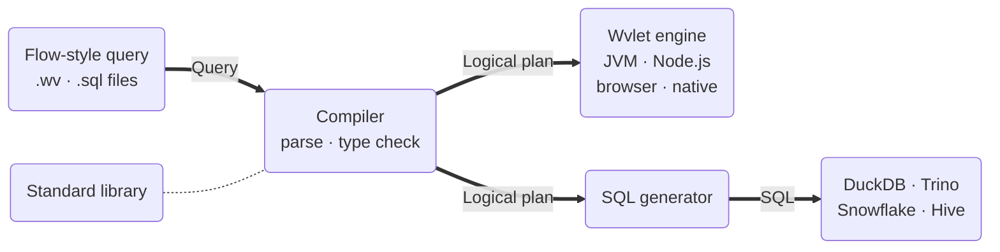
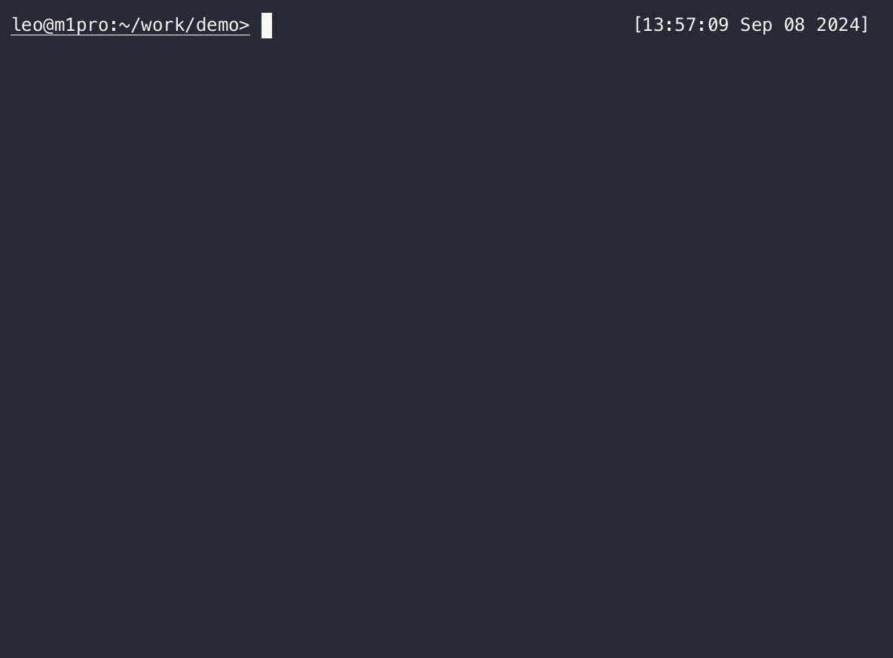
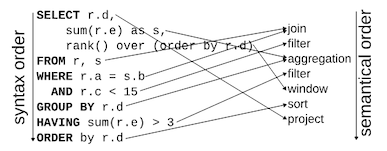

[](https://deepwiki.com/wvlet/wvlet)

Wvlet, pronounced as weave-let, is a flow-style query language with a columnar query engine built in. Queries start from a table and pipe it through operators in the order data flows. The Wvlet engine runs them in-process on the JVM, as a native binary, in Node.js, or in the browser, and the same query also compiles to SQL for [DuckDB](https://duckdb.org/), [Trino](https://trino.io/), [Snowflake](https://www.snowflake.com/), and [Hive](https://hive.apache.org/).

- [Documentation](https://wvlet.org/wvlet/)
- [Wvlet for AI Agents](https://wvlet.org/wvlet/docs/for-ai-agents): syntax cheat sheet, SQL-to-Wvlet mapping, and common mistakes
- [Milestones](https://github.com/wvlet/wvlet/milestones)
- [Project Roadmap](https://github.com/orgs/wvlet/projects/2)

AI coding agents: the docs are available as plain text at [llms.txt](https://wvlet.org/wvlet/llms.txt) (index) and [llms-full.txt](https://wvlet.org/wvlet/llms-full.txt) (all pages).





## Why Wvlet?

Wvlet queries (saved as .wv files) provide a natural way to describe data processing pipelines, which run on the Wvlet engine or compile into a sequence of SQL queries. While SQL is a powerful language for processing data, its syntax often does not match the semantic order of data processing. Let's see the following example: The syntactic order of SQL's SELECT ... statements mismatches with the actual data flow inside the SQL engines (cited from _[A Critique of Modern SQL And A Proposal Towards A Simple and Expressive Query Language (CIDR '24)](https://www.cidrdb.org/cidr2024/papers/p48-neumann.pdf)_):



For overcoming this shortcoming of SQL, Wvlet starts from a table scan statement `from ...`, and the result can be streamlined to the next processing operators like `where`, `group by`, `select`, etc., as if passing table values through [a pipe](https://en.wikipedia.org/wiki/Pipeline_(Unix)) to the next operator: 

```sql
from (table)
where (filtering condition)
...
where (more filtering condition can be added)
group by (grouping keys, ...)
where (group condition can be added just with where)
select (columns to output)
order by (ordering columns...)
limit (limiting the number of output rows)
```

With this flow style, you can describe data processing pipelines in a natural order to create complex queries. You can also add operators for testing or debugging data in the middle of the query. This flow syntax is gaining traction and has been adopted in Google's SQL to simplify writing SQL queries. For more details, see _[SQL Has Problems. We Can Fix Them: Pipe Syntax In SQL (VLDB 2024)](https://research.google/pubs/sql-has-problems-we-can-fix-them-pipe-syntax-in-sql/)_.

## Key Features

- **Flow-style syntax**: Write queries in the natural order of data processing
- **Built-in engine**: Runs all 22 TPC-H and 99 TPC-DS queries, with steady-state speed on par with DuckDB at scale factor 10 ([setup and numbers](https://wvlet.org/wvlet/docs/engines/wvlet-engine-performance))
- **Multi-database support**: Compiles the same query to SQL for DuckDB, Trino, Snowflake, and Hive
- **Interactive REPL**: Explore data interactively with auto-completion
- **Type-safe queries**: Catch errors at compile time with schema validation
- **Modular queries**: Organize and reuse queries as functions

## For AI Agents

Wvlet ships an Agent Skill that teaches coding agents its syntax, SQL mapping, tests, and CLI. CI compiles every example in it against the current compiler. In Claude Code:

```text
/plugin marketplace add wvlet/wvlet
/plugin install wvlet@wvlet
```

See [Wvlet for AI Agents](https://wvlet.org/wvlet/docs/for-ai-agents) for other agents.

## Contributors

Many thanks to everyone who has contributed to our progress:

[](https://github.com/wvlet/wvlet/graphs/contributors)
