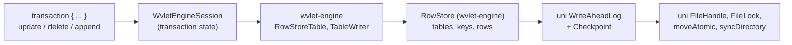

# A transactional row store for small shared state

Status: proposal for review. No implementation code yet. ADR draft: [`adr/2026-11-24-row-store.md`](../adr/2026-11-24-row-store.md).

## Goals

- Wvlet serves SQLite-like workloads next to its columnar analytics: small shared state (up to tens of MB), row-at-a-time reads and writes, several processes on one machine writing concurrently, multi-statement transactions.
- The first user is a benchmark lock and queue that coordinates benchmark runs across coding sessions on one machine (the local Mac, the GB10 GPU host). `scripts/bench-run` uses `sqlite3` for now; this design lets it move to `wvlet run` without changing its schema or its claim semantics.
- The same store works on the JVM and Scala Native, and is readable from Node.js. It needs no native library: no libsqlite3, no JDBC driver.
- A compare-and-set claim ("take the oldest unfinished row") is one Wvlet statement, and its atomicity is proven, not assumed.

## Non-goals

- Analytics tables. Large or append-mostly tables stay in the Iceberg warehouse ([ADR](../adr/2026-11-22-engine-warehouse-catalog.md)); the row store is not a second analytics format.
- Data larger than memory, secondary indexes, and a B+tree page file. The format is versioned so a page file can replace the snapshot file later (see [Later](#later)).
- Several writers at once (MVCC writes, row locks). Writers are serialized; this is SQLite's WAL-mode model, and enough for the queue's write rate.
- More than one host, and network file systems (NFS, SMB, iCloud folders), whose locks are not reliable. The store refuses to open a path on a known network mount when the platform can tell.
- Writes from Node.js and the browser in the first version (Node.js has no file-lock API; see [locking](#file-locks)). Node.js reads are supported.
- SQLite file compatibility and the SQL dialect of SQLite.
- Replacing `SQLiteItemStore` (the activity store) in this work; it is listed under [Later](#later) because it touches a Lean-gated area.

## Background

- Writes already exist in the language: `append to t` (insert), `append to t on k` (insert or update, `MERGE INTO`), `from t where ... delete`, `from t where ... update c = e` (`UpdateColumns`, SQL generation only; the engine does not run it yet), and `truncate`. See [table management](../website/docs/syntax/table-management.md).
- The engine persists tables as Iceberg tables in a `warehouse` folder. Every write is one Iceberg commit with copy-on-write files and optimistic concurrency on `vN.metadata.json`. A one-row update there rewrites a data file, a manifest, a manifest list, and a metadata file, and keeps the old files for time travel. That is right for analytics and wrong for a queue that changes one row per second.
- The runner already depends on SQLite on the JVM (`SQLiteItemStore`, `sqlite-jdbc`, WAL mode, `busy_timeout`) for cross-process activity claims, which shows the workload is real and what it needs. It does not exist on Scala Native or Node.js.
- uni `FileSystem` (origin/main `129b5bd8`) has whole-file reads and writes, `WriteMode.CreateNew` (`CREATE_NEW` / Node `wx` / Native exclusive create), and `move`. It has no positional reads or writes on an open file, no `fsync`, no directory sync, and no file locks. `move` is not guaranteed atomic: the JVM omits `ATOMIC_MOVE`, and Native falls back to copy-then-delete when `rename` fails. `ObjectStore.putIfMatch` exists for object storage but has no local-file counterpart. uni has no CRC32C.

## Design

Lane: Standard. Always-gate areas: data storage (new on-disk format, fsync and recovery), new syntax, and a new Lean model.

### Shape of the solution



- **uni** gets the platform primitives and a generic, byte-level write-ahead log with checkpoints. Neither knows about tables or Wvlet types, so other uni users (settings, activity stores) can reuse them.
- **wvlet-engine** gets `RowStore`: tables with schemas and primary keys, kept in memory and made durable through the uni log. Reads expose a table as an ordinary `TableSource`, so every query operator works on it unchanged.
- **wvlet-lang** gets `transaction { ... }`, `order by` / `limit` before `update` and `delete`, and a `select` after a write that returns the changed rows.
- **wvlet-runner** keeps the open transaction of a session and maps lock timeouts and failed assertions to rollbacks and exit codes.

### On-disk format

A database is a folder `<name>.wvdb/`, so it can be attached by path (`use 'bench.wvdb' as bench`) and copied as one unit:

| File | Role |
| --- | --- |
| `lock` | Empty file the writer lock is taken on. Never deleted, never renamed. |
| `snapshot-<g>` | Checkpoint of generation `g`: a header (magic, format version, `g`, schema catalog), then every table's rows, MessagePack-encoded, sorted by key, with a trailing CRC32C. Written to a temp file, fsynced, renamed into place, then the folder is fsynced. |
| `wal-<g>` | Redo log since `snapshot-<g>`. Frames of `[length][crc32c][payload]`; a payload is one transaction: `txid`, then `put(table, key, row)` / `delete(table, key)` / DDL records, then a commit marker. One frame per transaction, so a frame is either fully committed or ignored. |

- **Why a log plus a snapshot, not a B+tree.** The target is small shared state that fits in memory. A log plus snapshot needs no page cache, no free-list, and no torn-page handling: recovery reads the newest valid snapshot and replays whole frames whose CRC matches, stopping at the first bad or short frame and truncating the tail. That is small enough to model in Lean and to fuzz with truncated files. A B+tree page file is the later step if the data outgrows memory.
- **Checkpoint.** When `wal-<g>` passes a threshold (default 4 MB, or on `close`), the writer, still holding the lock, writes `snapshot-<g+1>` from memory and creates an empty `wal-<g+1>`, fsyncs both and the folder, then deletes the older generation. A reader that still has `wal-<g>` open keeps reading the old inode on POSIX; on Windows deletes of open files are deferred (`FILE_SHARE_DELETE`) or retried at the next checkpoint.
- **Generation discovery.** The current generation is the highest `g` with a valid `snapshot-<g>`. There is no pointer file to disagree with the folder, as in the warehouse ADR. A crash between steps leaves either the old generation (new snapshot not yet renamed) or both (old one not yet deleted); recovery picks the highest valid one and deletes the rest under the lock.
- **Durability levels.** `sync: full` (default) fsyncs the WAL before a commit returns; on macOS this uses `F_FULLFSYNC`, because `fsync` there does not flush the drive cache. `sync: normal` fsyncs only at checkpoints, as SQLite's `synchronous=NORMAL` in WAL mode; a power loss can lose recent commits but never corrupts. `sync: off` is for tests.

### Transactions, isolation, and concurrency

- **One writer at a time, readers never wait.** A write transaction takes an exclusive OS lock on `lock` for its whole duration. Readers take no lock: each statement reads the committed state at its start (the snapshot plus the WAL frames whose commit marker it saw), so reads never block writes and never see a partial transaction.
- **Isolation level: serializable for writes, snapshot for reads.** Because writers are serialized and a write transaction reads the latest committed state after it holds the lock, every write transaction is serializable. A read-only transaction sees one consistent snapshot for all its statements.
- **The compiler decides when the lock is taken.** SQLite's deferred transactions upgrade to a write lock at the first write and fail with `SQLITE_BUSY_SNAPSHOT` when another writer committed in between. In Wvlet a `transaction { ... }` block is compiled as a whole, so the compiler knows whether it writes. A writing block takes the lock before its first statement and re-reads the latest state; a read-only block takes none. This removes the busy-snapshot failure, which is a common bug in shell wrappers around `sqlite3`.
- **Waiting.** A writer waits for the lock up to `lock_timeout` (default 10 s, the same as the activity store's `busy_timeout`), polling with backoff, then fails with a new `StatusCode.TRANSACTION_LOCK_TIMEOUT`. The transaction has not started, so the caller can retry.
- **Crash while holding the lock.** The OS releases the lock when the process dies. The next writer runs recovery before its transaction (truncate the torn WAL tail). Logical leases (a benchmark lock held by a session that crashed) are an application concern: store `acquired_at` and the holder, and take over stale ones with a conditional update (see the [example](#example-the-benchmark-lock-and-queue)).
- **Reads in other processes.** A reader keeps the last WAL offset it applied and, at each statement, reads frames past it if the WAL grew or the generation changed. For a small store this costs one `stat` per statement.

### Wvlet syntax

Existing write operators keep their meaning. On a row-store table each statement outside a block is its own transaction (autocommit).

```wvlet
-- Insert, upsert, delete, update (all exist today)
append to bench.jobs { from [['q1', 'queued', now()]] as t(id, state, created_at) }
append to bench.jobs on id { from staged_jobs }
from bench.jobs where state = 'done' and finished_at < now() - '7 days':interval delete
from bench.jobs where id = 'q1' update state = 'cancelled'
```

New forms:

1. **`transaction { ... }`** runs its statements as one transaction. It commits when the block ends, and rolls back when a statement fails, a `test` assertion inside it fails, or the session ends first. It is a block, not `begin` / `commit` statements, because Wvlet pipelines are files of statements and a block cannot be left open by mistake. Nesting is an error in the first version (no savepoints). `.sql` files may use `BEGIN` / `COMMIT` / `ROLLBACK`, which the SQL parser maps to the same plan node; a `BEGIN` without a matching end in the same file is a compile error.
2. **`order by` and `limit` before `update` and `delete`.** Today the input of `update` / `delete` must be filters over one table. Allowing `order by` and `limit` makes "the oldest queued row" expressible: `from t where state = 'queued' order by created_at limit 1 update ...`. The engine applies it directly; SQL generation rewrites it to `where <key> in (select <key> from t where ... order by ... limit n)` for engines without `UPDATE ... LIMIT`, and the table must have a primary key (or DuckDB's `rowid`).
3. **A `select` after a write returns the changed rows.** `... update state = 'running' select id, cmd` returns the updated rows with their new values (`delete` returns the deleted rows; `append` the inserted ones). It compiles to `RETURNING` on DuckDB and is a compile error on engines without it. This is how a claim tells the caller what it got: an empty result means another session won.

The claim is one statement, so it is atomic without a block:

```wvlet
from bench.jobs
where state = 'queued'
order by created_at
limit 1
update state = 'running', owner = 'session-42', started_at = now()
select id, cmd
```

A compare-and-set on a known row is an `update` whose `where` states the expected old value; zero returned rows means the swap lost. A block is needed only when several statements must agree:

```wvlet
transaction {
  from bench.locks
  where name = 'gpu' and (holder is null or acquired_at < now() - '2 hours':interval)
  update holder = 'session-42', acquired_at = now()
  select name
  test _.size should be 1   -- lost the race: roll back, exit non-zero

  append to bench.runs { from [['session-42', 'gpu', now()]] as t(owner, resource, started_at) }
}
```

Open questions for review (defaults proposed):

- `select` after a write versus an explicit `returning` keyword. Proposed: `select`, because a write that yields rows reads as one more flow step, and Wvlet already reserves `select` for projection.
- `test` inside `transaction` as the abort mechanism versus an explicit `rollback` statement. Proposed: `test` only in the first version; it already reports why it failed.
- Whether `append to t on k` should get an "insert if absent" variant (`on k if absent`, SQL `ON CONFLICT DO NOTHING`). Proposed: defer; the conditional `update` covers the lock case.

### Engine, connector, and runner

- **Attaching a store.** `use '<path>.wvdb' as <alias>` attaches a row store on the `wvlet` connector, reusing the existing attach syntax: the `.wvdb` suffix selects it, as `.duckdb` selects DuckDB. `create table` on `<alias>.t` creates a row-store table. A connector property (`rowstore: <path>`) attaches one as the session's default schema, for scripts like `bench-run` that don't want a `use` line. No new `ConnectorFactoryProvider` is needed: the row store is storage of the `wvlet` connector, as the warehouse is.
- **Primary keys.** A row-store table needs a `primary key` (one or more columns, declared with the existing `table` constraint syntax), or gets a hidden `_rowid` like SQLite. Rows are kept in a sorted map per table, keyed by the encoded key. `unique` and `not null` are checked at commit.
- **Reads.** `RowStoreTable` implements `TableSource` and returns the snapshot as one or a few columnar batches, built on demand and cached per committed version. The planner treats it as a small in-memory table, so joins between row-store tables and warehouse or Parquet tables work. A point lookup on the key (`where id = 'q1'`) is served from the map without building batches.
- **Writes.** `TableWriter` dispatches `append`, `append on`, `update`, `delete`, and `truncate` on a `RowStoreTable` to the row store's transaction API instead of the Iceberg path. `update` is implemented for row-store tables first; the warehouse path keeps rejecting it until a separate change.
- **Optimizer toggles.** The engine rule puts every executor or planner change behind an `Optimization`. The row store is a new storage and statement path, not a plan rewrite of existing queries, so it gets no toggle; a point-lookup shortcut in the planner, if added, does (`rowstore_point_lookup`).
- **Runner.** `WvletEngineSession` holds at most one open transaction. Statements outside `transaction { }` autocommit. A failed statement or `test` inside a block rolls back and the block's error is reported; `wvlet run` exits non-zero. Other targets: `transaction { }` compiles to `BEGIN` / `COMMIT` on DuckDB and is a compile error on Trino, Snowflake, and Hive in the first version.

### uni primitives

All of these live in `uni-core` (`wvlet.uni.io`) behind the existing `FileSystemImpl` split, except the log, which goes in `uni` (`wvlet.uni.store`). Each has a shared trait and a per-platform implementation.

| Primitive | JVM | Scala Native | Node.js | Browser |
| --- | --- | --- | --- | --- |
| `FileHandle`: `open(path, mode)`, `read(pos, buf)`, `write(pos, buf)`, `append(buf)`, `size`, `truncate(n)`, `sync(dataOnly)`, `close` | `FileChannel` | POSIX `open` / `pread` / `pwrite` / `ftruncate` / `fsync` / `fdatasync`; Windows `CreateFileW` / `ReadFile` with `OVERLAPPED` / `FlushFileBuffers` | `fs.openSync` / `readSync(position)` / `writeSync` / `ftruncateSync` / `fsyncSync` / `fdatasyncSync` | unsupported |
| `sync` with full flush on macOS | `FileChannel.force(true)` does not issue `F_FULLFSYNC`; documented as `normal` strength on macOS unless a Native helper is used | `fcntl(fd, F_FULLFSYNC)`, falling back to `fsync` | `fsyncSync` (no `F_FULLFSYNC`); same caveat | — |
| `FileSystem.syncDirectory(dir)` | `FileChannel.open(dir, READ).force(true)`; no-op on Windows | `open(dir, O_RDONLY)` + `fsync`; no-op on Windows | `openSync(dir, 'r')` + `fsyncSync`; no-op on Windows | — |
| `FileSystem.moveAtomic(src, dst)`: replace `dst` atomically, never copy | `Files.move(ATOMIC_MOVE, REPLACE_EXISTING)`; throws if the file system cannot | `rename(2)`; Windows `MoveFileExW(MOVEFILE_REPLACE_EXISTING \| MOVEFILE_WRITE_THROUGH)`; throws instead of copying | `renameSync` | — |
| `FileLock`: `FileHandle.lock(exclusive, timeout)` / `tryLock`, released on `close` or process exit | `FileChannel.lock` / `tryLock` (POSIX `fcntl` record locks, Windows `LockFileEx`), plus a process-wide map so two handles in one JVM exclude each other instead of throwing `OverlappingFileLockException` | `fcntl(F_SETLK / F_SETLKW)` on POSIX, so it excludes JVM `FileChannel.lock` holders; `LockFileEx` on Windows | unsupported in v1: Node.js has no lock API, and a lock-file emulation would not exclude JVM or Native holders | — |
| `CRC32C` (shared, pure Scala, table-driven) | same code | same code | same code | same code |
| `WriteAheadLog` + `Checkpoint` (shared, in `uni`) | built on the above | built on the above | read-only (open, replay, follow) | — |

- **Why `fcntl`, not `flock`, on Native.** The JVM's `FileChannel.lock` uses `fcntl` record locks on Linux and macOS, and `flock` locks do not exclude `fcntl` locks on Linux. A JVM `wvlet` and a native `wvc` must exclude each other on the same store, so Native uses `fcntl` too. `fcntl` locks are per process and are dropped when any descriptor of the file in that process closes, so `FileLock` keeps one descriptor per path per process and reference-counts it; the same map serves the JVM.
- **Why Node.js is read-only.** There is no portable advisory-lock API in Node.js, and a lock file created with `wx` would neither exclude JVM or Native writers nor be released on a crash. A writer on Node.js needs an addon or a server, which is out of scope. Readers need no lock, so they work.
- **`move` stays as it is.** Its copy fallback is useful for cross-device moves; `moveAtomic` is a separate method so callers that need atomicity say so.

## Phases

Each phase is its own PR. uni PRs need a separate go-ahead before work starts there.

1. **uni: file primitives** (wvlet/uni). `FileHandle`, `FileLock`, `syncDirectory`, `moveAtomic`, `CRC32C`, with an ADR in uni. Tests: shared tests on JVM, Native, and Node (lock tests skip on Node); a two-process lock test that starts a child JVM (and a child native binary on the Native job) and checks exclusion and release on `kill -9`; `moveAtomic` never leaves a partial target. Bump uni in wvlet.
2. **uni: write-ahead log and checkpoints** (wvlet/uni). `WriteAheadLog` (frame, commit, replay, follow from an offset, truncate the torn tail) and `Checkpoint` (generations, atomic snapshot install, cleanup). Tests: replay after truncating the log at every byte offset of a small workload; a flipped byte stops replay at that frame; a crash injected between each checkpoint step recovers the latest committed state. Bump uni in wvlet.
3. **wvlet: syntax and SQL generation.** `TransactionBlock` plan node in the Wvlet and SQL parsers; `order by` / `limit` before `update` / `delete`; `select` after a write. Typer rules (a returning `select` sees the target's columns), DuckDB SQL generation (`BEGIN` / `COMMIT`, `RETURNING`, the keyed `in (select ...)` rewrite), compile errors on other engines. Spec files under `spec/basic` and DuckDB tests. Docs: `table-management.md`, `for-ai-agents.md`, and the bundled skill, which `SkillSnippetTest` and `SkillFreshnessTest` gate.
4. **wvlet: Lean model, then the engine row store.** First `formal/WvletFormal/RowStore/`: commit, crash at any point, recovery, and the single-writer lock over interleavings of several sessions. Theorems: recovery yields exactly a prefix of the committed transactions; a committed transaction is never lost under `sync: full`; a claim (`order by ... limit 1 update`) gives each row to at most one session and never skips the oldest eligible row. `lake exe row-store-traces` writes the fixture; `RowStoreConformanceTest` replays it against `RowStore`. Then `RowStore`, `RowStoreTable`, the `TableWriter` dispatch, `use '*.wvdb'`, and the `rowstore` connector property. Tests: engine conformance against DuckDB for reads and single-statement writes; a multi-process claim test (N JVMs claiming from one queue, every job claimed once). Add the model's row to [formal verification](../design/formal-verification.md).
5. **wvlet: runner and the benchmark queue.** Session transaction state, `lock_timeout` and `sync` properties, exit codes, and a worked example in `spec/` with the bench lock and queue schema. Moving `scripts/bench-run` from `sqlite3` to `wvlet run` is a separate PR once that script lands. Update [connectors](../design/connectors.md) and [engine](../design/engine.md) with the row store's contracts.

### Example: the benchmark lock and queue

```wvlet
table bench.locks = {
  name: string primary key
  holder: string
  acquired_at: timestamp
}

table bench.jobs = {
  id: string primary key
  cmd: string
  state: string not null = 'queued'   -- queued, running, done, failed
  owner: string
  created_at: timestamp not null = now()
  started_at: timestamp
  finished_at: timestamp
}
```

`bench-run` enqueues with `append to bench.jobs`, claims with the single-statement claim above, and finishes with `from bench.jobs where id = $id and owner = $me update state = 'done', finished_at = now()`. A run that died leaves a `running` row; a sweeper resets rows whose `started_at` is older than the timeout, with the same conditional update.

## Risks

- **Durability on macOS through the JVM.** `FileChannel.force` does not issue `F_FULLFSYNC`, so a JVM commit survives a process crash but maybe not a power loss. Accepted for the bench queue; documented, and Native gets full strength.
- **`fcntl` lock semantics.** Closing any descriptor of the lock file drops the process's lock. Mitigated by one reference-counted descriptor per path per process; any other code that opens `lock` would break it, which is why the store owns that file.
- **Readers following the log.** A reader can see a WAL generation deleted under it. On POSIX the open descriptor keeps it readable; on Windows the checkpoint retries the delete. Covered by the checkpoint crash tests.
- **Scope creep toward a general OLTP database.** The non-goals are the guard: no indexes, no multi-writer MVCC, no larger-than-memory data until a workload needs them.

## Later

- A B+tree page file behind the same `RowStore` interface when data outgrows memory (format version 2).
- Back `ItemStore` / `TaskQueue` with the row store, dropping `sqlite-jdbc` and making activity claims work on Scala Native. This changes a Lean-gated area (`WvletFormal/Activity/`) and needs its own plan.
- Writes from Node.js through a small native addon, or through a `wvlet` server that owns the store.
- `append to t on k if absent`, savepoints, and secondary indexes.
