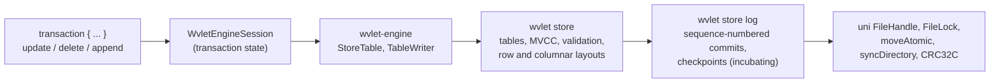

# A transactional store for shared state and the table catalog

Status: proposal for review. No implementation code yet. ADR draft: [`adr/2026-11-24-row-store.md`](../adr/2026-11-24-row-store.md).

## Goals

- Wvlet serves SQLite-like workloads next to its columnar analytics: small shared state, row-at-a-time reads and writes, several processes on one machine writing concurrently, and multi-statement transactions.
- The same store is the embedded storage layer of the planned table catalog: a single-writer commit log, catalog entities kept as rows, a file index kept as columns, reads pinned to a log position, and catalog-wide branches. This plan builds the layer and its first user; the catalog itself (replicas, branch operations, server-side pruning, Iceberg REST) is separate work on top of it.
- The first user is a benchmark lock and queue that coordinates benchmark runs across coding sessions on one machine (the local Mac, the GB10 GPU host). `scripts/bench-run` uses `sqlite3` for now; this design lets it move to `wvlet run` without changing its schema or its claim semantics.
- JVM and Scala Native read and write; Node.js reads. No native library: no libsqlite3, no JDBC driver.
- A compare-and-set claim ("take the oldest unfinished row") is one Wvlet statement, and its atomicity is proven, not assumed.

## Non-goals (for this plan)

- Replacing the Iceberg warehouse for analytics tables ([ADR](../adr/2026-11-22-engine-warehouse-catalog.md)). Data files stay Parquet / Iceberg; the store holds state and metadata.
- Several writers at once. One writer orders all commits, as in SQLite's WAL mode and the catalog design.
- Read replicas, log shipping, branch create / merge, retention and GC, and the Iceberg REST API. The format reserves what they need (sequence numbers, branch ids, retained log segments) so they can be added without a migration.
- More than one host for writes, and network file systems (NFS, SMB, iCloud folders), whose locks are not reliable.
- Writes from Node.js and the browser (Node.js has no file-lock API; see [locking](#uni-file-primitives)).
- Secondary indexes on row tables, and SQLite file or dialect compatibility.
- Replacing `SQLiteItemStore` (the activity store) in this work; see [Later](#later).

## Background

- Writes already exist in the language: `append to t` (insert), `append to t on k` (insert or update, `MERGE INTO`), `from t where ... delete`, `from t where ... update c = e` (`UpdateColumns`, SQL generation only; the engine does not run it yet), and `truncate`. See [table management](../website/docs/syntax/table-management.md).
- The engine persists tables as Iceberg tables in a `warehouse` folder; every write is an Iceberg commit (data file, manifest, manifest list, metadata file). A one-row update rewrites four files and keeps the old ones, which is right for analytics and wrong for a queue or a catalog that changes one row at a time.
- The runner depends on SQLite on the JVM (`SQLiteItemStore`, WAL mode, `busy_timeout`) for cross-process activity claims; it does not exist on Scala Native or Node.js.
- uni `FileSystem` (origin/main `129b5bd8`) has whole-file reads and writes, exclusive create (`WriteMode.CreateNew`), and `move`. It has no positional I/O on an open file, no `fsync`, no directory sync, no file locks, and no CRC32C. `move` is not guaranteed atomic: the JVM omits `ATOMIC_MOVE`, and Native falls back to copy-then-delete. `ObjectStore.putIfMatch` exists for object storage.
- The engine already scans Parquet with footer caching and row-group filters; uni writes Parquet. A columnar segment can be an ordinary Parquet file.

## Design

Lane: Standard. Always-gate areas: data storage (new on-disk format, fsync, recovery), new syntax, and new Lean models.

### Layers



- **uni** gets only the platform file primitives. They encode no policy, and any Scala app wants them.
- **The store log** (commit records, sequence numbers, checkpoints, recovery) incubates in Wvlet under its own package (`wvlet.lang.store.log`), with no dependence on table types, and graduates to uni once its API settles. A uni change costs a release plus a `UNI_VERSION` / `SCALA_VERSION` bump, so a log API that is still moving stays out of uni.
- **The store** (`wvlet.lang.store`, cross-platform, in `wvlet-engine`) owns tables, keys, MVCC visibility, commit validation, and the two table layouts. Everything a catalog means (what a table, branch, or generation is) builds on this, not inside it.
- **wvlet-lang** gets `transaction { ... }`, `order by` / `limit` before `update` and `delete`, and a `select` after a write that returns the changed rows.
- **wvlet-runner** keeps a session's open transaction and maps conflicts, lock timeouts, and failed assertions to rollbacks and exit codes.

### The commit log

- **One global sequence number.** Every commit is one log record with a sequence number `seq` that only grows across checkpoints and restarts. `seq` is the store's version: a read is pinned to a `seq`, caches are invalidated by it, and a later replica serves reads "as of `seq`" by replaying the same records.
- **Record format.** Frames of `[length][crc32c][payload]`. A payload is one commit: `seq`, `branch`, the reader's `read_seq`, its validation conditions, its writes (`put(table, key, row)`, `remove(table, key)`, segment add / remove, DDL), and a commit marker. One frame per commit, so a frame is either fully committed or ignored.
- **Segments of the log.** The log is a series of files `log-<first_seq>`. A checkpoint does not reset anything: it writes `checkpoint-<seq>` (the state as of `seq`), and log files wholly below the oldest retained position are deleted. That position is the minimum of the newest checkpoint and every registered reader or replica position, so a follower that falls behind can still catch up from the log.
- **Recovery.** Load the highest valid checkpoint, replay frames above its `seq` whose CRC matches, stop at the first bad or short frame, and truncate the tail under the writer lock. There is no pointer file to disagree with the folder: the current state is the highest valid checkpoint plus the valid log after it.
- **Checkpoint install.** Write to a temp file, fsync, `moveAtomic` into place, fsync the folder. A crash between steps leaves the previous checkpoint valid, and the log still covers everything after it.
- **Durability levels.** `sync: full` (default) fsyncs the log before a commit returns; on macOS Native uses `F_FULLFSYNC`, because `fsync` there does not flush the drive cache. `sync: normal` fsyncs only at checkpoints (a power loss can lose recent commits, never corrupt). `sync: off` is for tests.

### MVCC: every row carries its sequence range

- Every stored row, in both layouts, carries `added_seq` and `removed_seq` (null while live). An update is a remove plus an add in the same commit. A read at `seq` N sees rows with `added_seq <= N and (removed_seq is null or removed_seq > N)`.
- One visibility rule covers row tables and the columnar file index, so one Lean model covers both, and `from t as of <seq>` / `as of <time>` is cheap to add later.
- Old row versions stay while a pinned reader or retention policy needs them; checkpoints drop versions removed below the oldest retained position. In the bench queue, with no pinned readers, that is every removed version.
- **Branches are in the format from the start.** Every row key and log record carries a `branch` id, always `main` in this plan. A later branch adds a parent and a `fork_seq`, and a read on branch B resolves to the parent's rows at `fork_seq` plus B's own changes. Branch create / merge is not built here, but nothing has to be migrated to add it.

### Two table layouts

| | `layout: row` (default) | `layout: columnar` |
| --- | --- | --- |
| For | Small mutable state: queues, locks, catalog entities | Large, append-mostly, predicate-scanned data: the catalog's file index |
| Access | Point lookups by key, compare-and-set | Predicate scans, bulk appends |
| Storage | In memory: a sorted map per table from (branch, key) to row versions; durable through the log and checkpoints | A row-oriented delta in memory (durable through the log) plus immutable Parquet segments, sorted by a declared sort key, each with min / max per column |
| Reads | Built into columnar batches on demand, cached per `seq`; a key lookup skips the batches | Union of the segments that survive segment-level min / max pruning and the delta, filtered by the MVCC rule; segments go through the engine's ordinary Parquet scan, footer cache, and row-group filters |
| Larger than memory | No | Yes: only the delta must fit; segments are files |

- **Compaction** of a columnar table runs at the writer: it writes the delta's rows as a new Parquet segment (sorted by the sort key so min / max cluster), fsyncs it, and commits one log record that adds the segment and marks those delta rows as compacted. Segment files are immutable and named by the `seq` that added them. Rewriting segments to drop removed rows is the same kind of commit.
- **Where segments live.** In this plan, inside the store folder on local disk. The catalog's leaning (segments on object storage with a cache per node) needs only a different segment location, since segments are immutable and the log orders everything.
- This replaces the B+tree page file of the earlier draft: row tables stay in memory, and anything too large for memory is columnar.

### Commits, isolation, and concurrency

- **One writer.** Exactly one process is the writer of a store. Embedded, it is whoever holds the exclusive OS lock on the store's `lock` file; a later catalog service is the writer for all its clients. Readers take no lock.
- **The writer validates every commit.** A transaction reads at `read_seq` and submits its writes with validation conditions. The writer accepts it only if the conditions still hold at the current `seq`, appends one log record, and assigns the next `seq`. Otherwise the commit fails with a new `StatusCode.TRANSACTION_CONFLICT` and nothing is written.
  - **Appends commute.** A pure insert into a table without a unique-key clash carries no condition, so concurrent appends never conflict.
  - **Updates, deletes, upserts, and compaction validate** that the row versions they read (or the segments they replace) are still live: no commit between `read_seq` and now removed them.
  - **A statement that reads and writes runs at the writer.** `from t where ... order by ... limit 1 update ...` is evaluated by the writer against the current state, so the claim never conflicts: it either takes a row or returns none.
- **Isolation level.** Commits are serializable: validation rejects any transaction whose reads were changed by a commit after `read_seq`, and the writer orders accepted commits. A read-only statement or block sees one snapshot (its `read_seq`).
- **`transaction { }` and the lock.** A block is compiled whole, so the compiler knows whether it writes. Embedded, a writing block takes the writer lock before its first statement and reads at the latest `seq`, so its validation always passes; there is no SQLite-style `SQLITE_BUSY_SNAPSHOT`. This is a fast path over the same validated commit, not a different mechanism, so the same block also runs against a future catalog service by sending its write set and conditions in one request.
- **Waiting.** An embedded writer waits for the lock up to `lock_timeout` (default 10 s, as the activity store's `busy_timeout`), polling with backoff, then fails with a new `StatusCode.TRANSACTION_LOCK_TIMEOUT`.
- **Crash while holding the lock.** The OS releases the lock when the process dies; the next writer recovers before its transaction. Logical leases (a benchmark lock held by a session that crashed) are an application concern: store `acquired_at` and the holder, and take over stale ones with a conditional update.
- **Following the log.** A reader in another process keeps its last applied `seq`, and at each statement applies frames above it if the log grew. For a small store this costs one `stat` per statement. This is the replica's read loop, run locally.

### Store folder

A store is a folder `<name>.wvdb/`, attached by path (`use 'bench.wvdb' as bench`) and copied as a unit:

| Path | Role |
| --- | --- |
| `lock` | Empty file the writer lock is taken on; never deleted or renamed |
| `log-<first_seq>` | Commit log files |
| `checkpoint-<seq>` | State as of `seq`: header (magic, format version, `seq`, schema catalog), then each row table's live versions (MessagePack, sorted by branch and key), each columnar table's delta and segment list, and a trailing CRC32C |
| `segments/<table>/<seq>-<n>.parquet` | Immutable columnar segments |

### Wvlet syntax

Existing write operators keep their meaning. On a store table, each statement outside a block is its own transaction (autocommit).

```wvlet
-- Insert, upsert, delete, update (all exist today)
append to bench.jobs { from [['q1', 'queued', now()]] as t(id, state, created_at) }
append to bench.jobs on id { from staged_jobs }
from bench.jobs where state = 'done' and finished_at < now() - '7 days':interval delete
from bench.jobs where id = 'q1' update state = 'cancelled'
```

New forms:

1. **`transaction { ... }`** runs its statements as one transaction. It commits at the end, and rolls back when a statement fails, a commit conflicts, a `test` assertion inside it fails, or the session ends first. It is a block, not `begin` / `commit` statements, because Wvlet pipelines are files of statements and a block cannot be left open. Nesting is an error (no savepoints). `.sql` files may use `BEGIN` / `COMMIT` / `ROLLBACK`, which the SQL parser maps to the same plan node; an unmatched `BEGIN` is a compile error.
2. **`order by` and `limit` before `update` and `delete`.** "The oldest queued row" becomes `from t where state = 'queued' order by created_at limit 1 update ...`. The store runs it at the writer; SQL generation rewrites it to `where <key> in (select <key> from t where ... order by ... limit n)` for engines without `UPDATE ... LIMIT`, and needs a primary key (or DuckDB's `rowid`).
3. **A `select` after a write returns the changed rows.** `... update state = 'running' select id, cmd` returns the updated rows with their new values (`delete` the deleted rows, `append` the inserted ones). It compiles to `RETURNING` on DuckDB and is a compile error on engines without it. An empty result means another session won.

The claim is one statement, so it is atomic without a block:

```wvlet
from bench.jobs
where state = 'queued'
order by created_at
limit 1
update state = 'running', owner = 'session-42', started_at = now()
select id, cmd
```

A compare-and-set on a known row is an `update` whose `where` states the expected old value. A block is needed only when several statements must agree:

```wvlet
transaction {
  from bench.locks
  where name = 'gpu' and (holder is null or acquired_at < now() - '2 hours':interval)
  update holder = 'session-42', acquired_at = now()
  select name
  test _.size should be 1   -- lost the race: roll back, exit non-zero

  append to bench.runs { from [['session-42', 'gpu', now()]] as t(owner, resource, started_at) }
}
```

Table layout is a table option. `table` declarations take no options today, so this adds a `with key: value` clause like the one `create schema` and `use` already have:

```wvlet
table cat.files with layout: 'columnar', sort_by: 'table_id, partition' = {
  table_id: long
  partition: string
  path: string primary key
  row_count: long
}
```

Open questions for review (defaults proposed):

- `select` after a write versus an explicit `returning` keyword. Proposed: `select`, because a write that yields rows reads as one more flow step.
- `test` inside `transaction` as the abort mechanism versus an explicit `rollback`. Proposed: `test` only in the first version.
- An "insert if absent" variant of `append to t on k` (`on k if absent`). Proposed: defer; the conditional `update` covers the lock case.
- Syntax for `as of <seq>` reads and for branches. Proposed: out of this plan; branch syntax needs its own ADR together with the catalog.

### Engine, connector, and runner

- **Attaching a store.** `use '<path>.wvdb' as <alias>` attaches a store on the `wvlet` connector, reusing the existing attach syntax: the `.wvdb` suffix selects it, as `.duckdb` selects DuckDB. A connector property (`store: <path>`) attaches one as the session's default schema, for scripts like `bench-run`. No new `ConnectorFactoryProvider` is needed: the store is storage of the `wvlet` connector, as the warehouse is.
- **Keys.** A table needs a `primary key` (declared with the existing constraint syntax) or gets a hidden `_rowid`. `unique` and `not null` are checked by the writer at commit.
- **Reads.** `StoreTable` implements `TableSource` and pins the statement's `seq`. Row tables return cached batches; columnar tables return their pruned segments (as Parquet scans) plus the delta. Joins between store tables and warehouse or Parquet tables work unchanged.
- **Writes.** `TableWriter` dispatches `append`, `append on`, `update`, `delete`, and `truncate` on a `StoreTable` to the store's transaction API instead of the Iceberg path. `update` is implemented for store tables first; the warehouse path keeps rejecting it until a separate change.
- **Optimizer toggles.** The store is new storage, not a plan rewrite of existing queries, so the store itself gets no `Optimization`. Planner changes that use it do: `store_point_lookup` (key lookups skip batch building) and `store_segment_pruning` (segment-level min / max pruning).
- **Runner.** `WvletEngineSession` holds at most one open transaction. A failed statement, a conflict, or a failed `test` inside a block rolls back and is reported; `wvlet run` exits non-zero. On other targets `transaction { }` compiles to `BEGIN` / `COMMIT` on DuckDB and is a compile error on Trino, Snowflake, and Hive in the first version.

### uni file primitives

All in `uni-core` (`wvlet.uni.io`), behind the existing `FileSystemImpl` split.

| Primitive | JVM | Scala Native | Node.js | Browser |
| --- | --- | --- | --- | --- |
| `FileHandle`: `open(path, mode)`, `read(pos, buf)`, `write(pos, buf)`, `append(buf)`, `size`, `truncate(n)`, `sync(dataOnly)`, `close` | `FileChannel` | POSIX `open` / `pread` / `pwrite` / `ftruncate` / `fsync` / `fdatasync`; Windows `CreateFileW` / `ReadFile` with `OVERLAPPED` / `FlushFileBuffers` | `fs.openSync` / `readSync(position)` / `writeSync` / `ftruncateSync` / `fsyncSync` / `fdatasyncSync` | unsupported |
| Full flush on macOS | `FileChannel.force(true)` does not issue `F_FULLFSYNC`; documented as `normal` strength there | `fcntl(fd, F_FULLFSYNC)`, falling back to `fsync` | `fsyncSync`; same caveat as the JVM | — |
| `FileSystem.syncDirectory(dir)` | `FileChannel.open(dir, READ).force(true)`; no-op on Windows | `open(dir, O_RDONLY)` + `fsync`; no-op on Windows | `openSync(dir, 'r')` + `fsyncSync`; no-op on Windows | — |
| `FileSystem.moveAtomic(src, dst)`: replace `dst` atomically, never copy | `Files.move(ATOMIC_MOVE, REPLACE_EXISTING)` | `rename(2)`; Windows `MoveFileExW(MOVEFILE_REPLACE_EXISTING \| MOVEFILE_WRITE_THROUGH)` | `renameSync` | — |
| `FileLock`: `lock(exclusive, timeout)` / `tryLock` on a `FileHandle`, released on `close` or process exit | `FileChannel.lock` / `tryLock` (POSIX `fcntl` record locks, Windows `LockFileEx`), plus a process-wide map so two handles in one JVM exclude each other instead of throwing `OverlappingFileLockException` | `fcntl(F_SETLK / F_SETLKW)` on POSIX, so it excludes JVM holders; `LockFileEx` on Windows | unsupported | — |
| `CRC32C` (shared, pure Scala, table-driven) | same | same | same | same |

- **`fcntl`, not `flock`, on Native.** The JVM's `FileChannel.lock` uses `fcntl` record locks on Linux and macOS, and `flock` locks don't exclude `fcntl` locks on Linux. A JVM `wvlet` and a native `wvc` must exclude each other, so Native uses `fcntl`. `fcntl` locks are per process and are dropped when any descriptor of the file in that process closes, so `FileLock` keeps one reference-counted descriptor per path per process, on both platforms.
- **Node.js is read-only.** There is no portable advisory-lock API in Node.js, and a lock file created with `wx` would neither exclude JVM or Native writers nor be released on a crash. Readers need no lock.
- **`move` stays as it is.** Its copy fallback is useful across devices; `moveAtomic` is a separate method for callers that need atomicity.

## Lean models

One model family serves this store and the catalog, under `formal/WvletFormal/Store/`, built on the planned catalog commit models rather than beside them. Each part is written before its code, with a trace fixture and a conformance test.

- **Log and recovery** (`store-log-traces`, `StoreLogConformanceTest`): a crash at any point followed by recovery yields exactly a prefix of the acknowledged commits, and no acknowledged commit is lost under `sync: full`; `seq` is strictly increasing across checkpoints and restarts.
- **Commit validation** (`store-commit-traces`, `StoreCommitConformanceTest`): every accepted history is serializable; reordering concurrent appends gives the same live rows; a commit is rejected exactly when a row version it read was removed after its `read_seq`.
- **MVCC visibility** (`store-mvcc-traces`, `StoreMvccConformanceTest`): a read at N sees exactly the effects of commits up to N, in both layouts, before and after compaction and checkpoints.
- **Claims**: an `order by ... limit 1 update` claim gives each row to at most one session and never skips the oldest eligible row, under any interleaving of sessions.

Branch visibility, merge, replica reads, and GC safety extend the same family with the catalog work. Each model gets a row in [formal verification](../design/formal-verification.md) when its code lands.

## Phases

Each phase is its own PR. uni PRs need a separate go-ahead before work starts there.

1. **uni: file primitives** (wvlet/uni). `FileHandle`, `FileLock`, `syncDirectory`, `moveAtomic`, `CRC32C`, with an ADR in uni. Tests: shared tests on JVM, Native, and Node (lock tests skip on Node); a two-process lock test (child JVM, and a child native binary on the Native job) that checks exclusion and release on `kill -9`; `moveAtomic` never leaves a partial target. Bump uni in wvlet.
2. **wvlet: Lean models for the log, commits, and MVCC.** The first three models above, with fixtures, before any store code.
3. **wvlet: the store log** (`wvlet.lang.store.log`). Sequence-numbered frames, follow-from-`seq`, checkpoints, retained positions, recovery. Conformance test for the log model; replay after truncating the log at every byte offset of a small workload; a flipped byte stops replay at that frame; a crash between each checkpoint step recovers.
4. **wvlet: syntax and SQL generation.** `TransactionBlock` in the Wvlet and SQL parsers; `order by` / `limit` before `update` / `delete`; `select` after a write; the `layout` table option. Typer rules, DuckDB SQL generation (`BEGIN` / `COMMIT`, `RETURNING`, the keyed `in (select ...)` rewrite), compile errors elsewhere. Spec files under `spec/basic`, DuckDB tests, and docs: `table-management.md`, `for-ai-agents.md`, and the bundled skill (`SkillSnippetTest`, `SkillFreshnessTest`).
5. **wvlet: the store with row tables.** MVCC rows with `branch` = `main`, validated commits, the writer lock, `StoreTable` reads, the `TableWriter` dispatch, `use '*.wvdb'`, and the `store` connector property. Conformance tests for the commit and MVCC models and the claim property; engine conformance against DuckDB; a multi-process claim test (N JVMs claiming from one queue, every job claimed once).
6. **wvlet: runner and the benchmark queue.** Session transaction state, `lock_timeout` and `sync` properties, exit codes, and a worked example in `spec/` with the bench lock and queue. Moving `scripts/bench-run` from `sqlite3` to `wvlet run` is a separate PR once that script lands. Update [connectors](../design/connectors.md) and [engine](../design/engine.md) with the store's contracts.
7. **wvlet: columnar tables.** The delta plus Parquet segments, compaction commits, segment pruning behind `store_segment_pruning`, and MVCC over segments. This is the first piece the catalog's file index needs, and the bench queue does not.

The catalog (branch operations, replicas, retention and GC, server-side pruning, Iceberg REST) builds on phases 5 and 7 under its own plan.

### Example: the benchmark lock and queue

```wvlet
table bench.locks = {
  name: string primary key
  holder: string
  acquired_at: timestamp
}

table bench.jobs = {
  id: string primary key
  cmd: string
  state: string not null = 'queued'   -- queued, running, done, failed
  owner: string
  created_at: timestamp not null = now()
  started_at: timestamp
  finished_at: timestamp
}
```

`bench-run` enqueues with `append to bench.jobs`, claims with the single-statement claim above, and finishes with `from bench.jobs where id = $id and owner = $me update state = 'done', finished_at = now()`. A run that died leaves a `running` row; a sweeper resets rows whose `started_at` is older than the timeout, with the same conditional update.

## Risks

- **Scope.** Building for the catalog widens the v1 format (sequence numbers, sequence ranges, branch ids, retained positions) and adds validation. The bench queue needs none of the extra features, but it uses the format they need, so it never migrates. Columnar tables wait until phase 7, after the queue works.
- **Memory for row versions.** Old versions stay while a reader pins them. Pins are registered and bounded by a timeout, and checkpoints drop versions below the oldest retained position.
- **Durability on macOS through the JVM.** `FileChannel.force` does not issue `F_FULLFSYNC`, so a JVM commit survives a process crash but maybe not a power loss. Documented; Native gets full strength.
- **`fcntl` lock semantics.** Closing any descriptor of the lock file drops the process's lock. Mitigated by one reference-counted descriptor per path per process, and by the store owning `lock`.
- **Log retention.** A reader that registers a position and never advances would keep log files forever; registrations expire.

## Later

- The catalog on top of this store: branch create / merge, read replicas by log shipping, retention by name, write leases and GC, server-side pruning, and Iceberg REST.
- Graduating the store log to uni once its API settles.
- Back `ItemStore` / `TaskQueue` with the store, dropping `sqlite-jdbc` and making activity claims work on Scala Native. This changes a Lean-gated area (`WvletFormal/Activity/`) and needs its own plan.
- `as of` reads, `append to t on k if absent`, savepoints, and writes from Node.js (through an addon or a server that owns the store).
