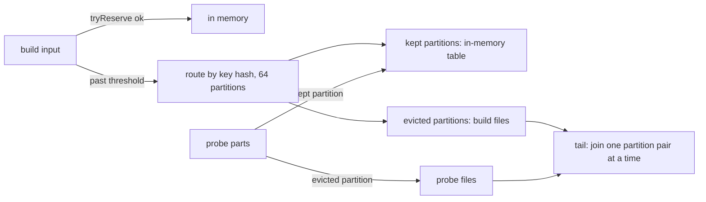

# Engine: grace hash join (spill join builds and probes to disk)

## Goals

- Join builds larger than the spill threshold finish instead of hitting `OutOfMemoryError` / RESOURCE_EXHAUSTED. First target: TPC-H q9 at SF100 on a 12 GB heap, which needs ~20 GB live today and runs out in the join build. Then the item-9 run (both suites at SF100, `-Xmx8g`).
- Spill only the hash partitions that don't fit (hybrid hash, item 5b's shape), so a build just over budget writes little.
- With `spill_join` off, or on but not spilling, plans and timings stay as they are.

## Background

- The spill framework (#2584) gives `MemoryContext.tryReserve` (false past the query's soft threshold, half the heap by default), a per-query spill folder, and `SpillBlocks` files. `PartitionedAggOp` spills all 64 partitions once it passes the threshold. Joins don't spill.
- `JoinBuild.buildTable` drains the whole right input with `reserve`, then concatenates it into one batch, encodes strings, packs keys, and builds a direct index, flat table, or per-partition `GroupTable`s. For a moment the input batches and the concatenated copy are both live, and the reservation counts only the batches plus 12 B/row. That's part of why q9 tracks 3.9 GB but holds ~20 GB (item 2b found join `int[]`s undercounted ~2x at SF10).
- In a morsel pipeline (`Parallelizer`), parts probe one shared `JoinBuild` in parallel. Right/full joins also get a `MorselOp.Tail`: one more run on the calling thread after every part, which emits unmatched build rows, and nested tails compose (the inner joins' tail rows probe the outer join). Inner, left, semi, and anti joins have no tail.
- Runtime filters (range, `RowKeyFilter` bitmap/Bloom, key-set row-group pruning) are set from all build keys before the probe scan starts. `RowKeyFilter` keeps at most 4M keys (`MaxKeys`); larger builds get a range only. `left_match_prefilter` (`BuildKeyMatch`) reads the build's table below the probe.
- DuckDB's radix-partitioned hash join spills partitions under `memory_limit`. DataFusion's hash join doesn't spill.

## Design

Lane: Standard. A new execution path in joins, an engine-wide behavior under memory pressure, and a new `Optimization` toggle.

- **Trigger.** The build reads its input with `tryReserve`. Each batch counts as itself plus what building on it will add: the concatenated copy, the valid rows, packed keys, the string-code copy, chains, and tables at their allocated capacity, instead of today's flat 12 B/row. So the build spills before the heap reaches what concat and indexing need, not after. Everything still goes through `MemoryContext`. Proposed split with item 2b: this PR counts `JoinBuild`'s structures, because the trigger depends on them, and 2b drops join arrays from its scope and keeps the other holders (q20 strings, the q13 overcount, process caches). The PR reports q9's tracked-to-live ratio at SF10 after the change.
- **Hybrid build.** When `tryReserve` first fails, the buffered batches and every later batch are routed into 64 partitions, chunk by chunk, as the aggregation router does. The route hashes the keys through the build-typed `GroupTable` hasher (the one probes already use for build-typed lookups), reseeded so the partition bits don't collide with the in-memory table's own partition bits. Partitions stay in memory until the next reservation fails, or until kept bytes reach half the threshold, which leaves room for the tail and for other builds in the query. Then the largest in-memory partition is written to its file and freed, and its later rows go straight to disk. When the input ends, the kept partitions become the ordinary in-memory build (direct, flat, or hashed table, all unchanged).
- **Probe.** Only for a spilled build: each probe batch hashes its keys with the same seeded hash. Rows of kept partitions probe the table as today. Rows of evicted partitions are buffered per task, with the buffers capped in bytes per task (parts run under `MemoryContext.NoOp`, so the cap is what bounds them). They're appended as blocks to that partition's probe file. Probe parts write in parallel, and blocks are appended under a per-file lock (order within a file doesn't matter).
- **Tail joins the spilled pairs.** After the probe input ends, the join first emits the kept partitions' unmatched rows (outer kinds), then frees the kept table and its reservation. Then it reads each evicted partition's build file into a fresh `JoinBuild` (parallel build, no runtime filters, reservation returned after the partition) and streams its probe file through the same `probeBatch` code. Output is gathered eagerly here, so no output batch points into a freed partition. Join kinds hold per partition, because a key's build and probe rows share one partition:
  - inner/left/semi/anti/exclusions decide per probe row;
  - right/full/right-semi/right-anti track matches per partition and emit unmatched build rows when the partition ends;
  - NULL keys: in plain joins, NULL-key probe rows that land in an evicted partition find no match there, so left/anti still emit them. In NULL-equal joins (INTERSECT/EXCEPT), rows with a NULL key go to one fixed partition on both sides, so they still meet.
- **Pipelines: the spill tail is decided at run time.** Plans, `hasTail`, and the union-pipeline and outer-tail choices stay as they are. After its parts, a `MorselOp` asks its segments' joins whether any build spilled. Only then does it run one more pass of the pipeline over an empty input, where each spilled join emits its spilled pairs once its left input ends. That pass is folded into the existing outer tail when there is one. So a spilled join's tail rows still flow through the joins above it, as nested outer tails do today. With one spilled build and no right/full join in the pipeline, the pass runs as one task per spilled partition (as `parallel_outer_tail` splits by build ranges); otherwise it is one streamed run on the calling thread.
- **Oversized partition.** A build file larger than half the threshold is split once more with another seed (build and probe files both), as the aggregation does. Deeper than that, it builds anyway and meets the hard limit, for example with one huge key.
- **Runtime filters from every key.** While routing, the build tracks the key range and keeps the integer keys only while there are at most `RowKeyFilter.MaxKeys` (≤32 MB). At the end it sets the same range, bitmap/Bloom, and key-set filters an in-memory build would have set. Above `MaxKeys` the filter is a range, also as today. A spilled build makes `BuildKeyMatch` keep every row, which is allowed (that filter only saves work).
- **Scope and toggle.** `spill_join` (an `Optimization` listed in `OptimizerOptionsTest`), copied at `Parallelizer`'s two rebuild sites, on by default like `spill_aggregation` (it acts only past the threshold, where the query would otherwise fail). JVM and Native only, like aggregation spill. Not covered: nested-loop builds, `AsOfJoinOp`, and builds or probes with `AnyT` columns (those reserve as before). Output order changes only when a join spills (it is unspecified anyway).
- **Tests and measurement.**
  - JVM tests force spills with tiny thresholds, for every join kind, NULL keys, a split partition, nested spilled joins in one pipeline, and cleanup after failure, comparing rows with the in-memory run.
  - On the Sparks: SF10 forced-spill benches (`-Dwvlet.engine.spillThreshold=256MB`) for TPC-H and TPC-DS with rows checked against DuckDB, a no-spill A/B with the toggle, then H q9 at SF100 on 12 GB.
  - Docs: an ADR and `design/engine.md` Spilling.

## Alternatives and Why Not?

- **Spill every partition once over (the current aggregation shape).** Simpler, but a build 10% over budget would write and re-read all of its probe side. For q9 that's a lineitem-sized probe.
- **Partition the build from the start.** It would cost every join the routing even when nothing spills, and the no-spill timings have to hold.
- **Spill the build only and re-scan the probe input per partition.** It avoids probe files but re-reads and re-filters the probe scan (and every operator below the join) once per wave.
- **Drop runtime filters for spilled builds.** It would make spilled queries scan much more. Range filters are free to keep, and exact filters only apply to ≤4M keys.
