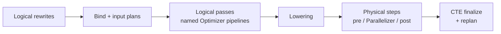

# Engine optimizer structure for maintainability

## Goals

- Stop structural traps from causing silent bugs. Each trap below has cost a PR or a wrong A/B:
  - an operator flag that a rebuild site forgot to copy (#2506);
  - a toggle that has to be disabled twice;
  - an identity-keyed cache that misses a copied subquery (#2464, #2526).
- Cut merge conflicts between the six engine-opt-loop sessions. Since 2026-11-19, 152 of the 259 engine commits touched `Planner.scala` and 133 touched `OptimizerOptions.scala`.
- Let a reader find where an optimization runs, which phase it belongs to, and which estimate it reads, without reading the 4,582-line `Planner.scala`.
- Get there through small, plan-identical PRs: golden plans unchanged, every toggle still working, no SF10 regression. The loop keeps landing optimizations meanwhile.

## Background

### Pipeline for one query

| Phase | Where | Input → output | Toggle reads |
| --- | --- | --- | --- |
| Logical rewrites (depth 1) | `DuplicateSubqueries`, `SharedScans`, scalar prefetch | logical plan → logical plan | a few, orchestration |
| Bind | `RuntimeBinder`, `Planner` builder traits | logical plan → `RuntimePlan` | ~13 bind-time |
| Input plans during binding | `RuntimeBinder.lowered`: full `Optimizer` run + `Lowering` per join/agg input | `RuntimePlan` → `Operator` (for estimates) | as below |
| Plan-time subqueries (~13 sites) | count IN, NOT IN values, EXISTS, scalars, group totals, `isCorrelated`, pivot | recurse into `Planner.plan` / `planRelation` | — |
| CTE key extension | `CTEJoinKeys` (own `Optimizer` run per body) | `RuntimePlan` → `RuntimePlan` | 1 |
| Logical passes | `Optimizer.defaultPasses`: 12 passes, already a declared list | `RuntimePlan` → `RuntimePlan` | per rule + ~45 inside passes |
| Lowering | `Lowering` (30 flags from `Planner.lower`) | `RuntimePlan` → `Operator` | 30 |
| Physical configuration | `Planner.optimizePhysical`: ColumnPruner, LeftMatchPrefilter, 9 `disable*` walkers, configureFilters, markUnmatchedLeftProbes, configureJoin, `Parallelizer` (19 flags), 10 more `disable*` walkers | `Operator` → `Operator` | ~60 |
| CTE finalization | `finalizeCTEs`: six Optimizer pieces one by one, then lower + configure | per CTE body | 10 |
| Replan | `replan_materialized_ctes`: new `Optimizer` instances, deliberately not counted in `firedRules` | root and CTE bodies | 3 |

### Sizes

- `Planner.scala` 4,582 lines, `Operators.scala` 2,379, `VExpr.scala` 1,687, `Binder.scala` 1,675, `RuntimeBinder.scala` 1,223, `OptimizerOptions.scala` 1,223 (149 toggles), `Parallelizer.scala` 968, `Lowering.scala` 747, `Stats.scala` 709.
- `Operators.scala` and `VExpr.scala` already make scalafmt reflow unrelated code.
- `design/engine.md`'s planning-path section has become a 55-bullet log of toggles, which `design/AGENTS.md` asks pages not to be.

### Caches and memo tables

| Table | Key | Lifetime |
| --- | --- | --- |
| `scalarResults`, `prefetchTried`, `inShareDeclined`, `correlatedSubqueries` (`planning_memo`) | identity of the subquery `Relation` | per Planner; `nested(p) = p`, so subqueries share it |
| `sharedScans` | identity of the `Filter`; `expandedSharedScans` falls back to `Span` + `==` (`match_copied_subquery_scans`) | per Planner |
| `boundInputs` (RuntimeBinder) | identity of the optimized `RuntimePlan` | per root plan |
| `cteRefs` | CTE name, checked with `eq` on the definition | per Planner |
| `cteDefs`, `cteRefCounts` | CTE name | per Planner |
| `inGroupsComputed` | structural tuple (`HashMap[Any, …]`) that includes a `Relation` | per Planner |
| `exprKeys` | `Expression` case-class equality | per Planner |
| `DeferredCTE.distinctCounts` / `passingRows` | column position / `VExpr` | per CTE |
| `Binder.templateCache` | template string | process |
| `ParquetFooterCache`, `ParquetSource.estimatedDistinct` / `valueCounts` LRUs | path + file version (+ column) | process |

- The five identity-keyed tables miss a copy that `transform` or `expandTemplates` made.

### Estimate sources

- `CardinalityEstimator` is the shared formula library: `DefaultSelectivity` (0.3, defined once), `joinOutputRows`, `compositeDivisor`. It also estimates rows over lowered `Operator`s for the binder.
- `Stats` estimates over `RuntimePlan` (rows, `treeRows`, distinct values, ranges, key coverage, selectivity) and calls `CardinalityEstimator` for the join formulas. It is used by passes and the join search.
- `Stats.rows` and `CardinalityEstimator.rows` mirror each other's row rules, with known differences: one-row Values, CTE refs, inner joins.
- Range selectivity is implemented twice: `RangeSelectivity` (through Stats) and the inline narrowing in `ScanFilters.selectivity`.
- `JoinEnumerator` and `JoinOrderOptimizer.greedy` have their own costs over `JoinSearch` callbacks, which have two implementations (operators and `RuntimePlan`).
- Pass-local estimates live in `EagerAggregation.distinct`/`outerGroups`, `RankFilterRows` and `ClusteredGroups`.
- Source statistics come from Parquet footers and the LRUs above.
- Nothing in the estimators is memoized.

### Where the traps come from

- **Operator flags are mutable `var`s, copied by hand.** `HashJoinOp`/`JoinBuild` have 9, `HashAggOp` 10, `DistinctOp` 2.
  - Rebuild sites: `Parallelizer` (`:229`, `:707`, `:615`, `:544/558`, the TwoPhaseAgg partial, tail and final at `:900/925/959`, DistinctOp at `:597/666/693/703`), `ColumnPruner` (`:167/171/310`), `LeftMatchPrefilter` (`:82/93/193`), `Operators.withLeft`.
  - Most sites run before the flags are set. The Parallelizer sites run after, and copy the flags one by one.
  - Some Parallelizer sites leave flags out today:
    - the single-thread `HashAggOp` fallbacks at `:544/558`;
    - `withOneRowPartials` on the partial tail.
  - `ColumnPruner` leaves out `nullsEqual`. That is latent: only Parallelizer sets it, and Parallelizer runs afterwards.
  - `ScanOp` already avoids the trap with a private `withFlagsOf`.
- **Toggle reads are spread across phases.** See the toggle column above. Four flags (late gather, dense selected rows, scratch buffers, column-major sums) are applied both before and after Parallelizer. Lowering's accelerator fallback passes 19 of the 30 flags.
- **One `Planner` holds every concern and all shared state.** Its state fields and most helpers are `private`.
- **Duplicated logic:**
  - `factorOr` exists twice: on the AST in Planner, and on `VExpr` in `Normalize` (Lean-modelled).
  - Conjunct splitting exists three times.
  - The "keep the output columns' order" Project is written twice.
  - Plan, lower and configure is open-coded about five times. The plan-time sites use either `plan` or `planRelation`.
- **Lean models** cover several Planner pieces: `correlatedJoin`, `decorrelateExists`/`decorrelateScalar`, NOT IN, and others. Moving their code is allowed when the logic is unchanged and `design/formal-verification.md` names the new place. The conformance tests construct `Planner(...)`, so a move doesn't break them.

## Design

Lane: Standard. The work is internal and plan-identical, but it reshapes the files that six parallel sessions edit, so the order and boundaries need the user's call.

Target structure:

- **Phases are declared, not open-coded.**
  - Logical passes stay in `Optimizer`, which gets named pipelines: root, CTE body finalize, replan, and key extension.
  - Fired-rule counting stays as today: the replan and key-extension runs remain separate instances, so tests still count each rule of the plan once.
  - Physical configuration moves out of `Planner` into one declared list of steps (pre-parallelize, Parallelizer, post-parallelize). A toggle that has to hold on both sides of Parallelizer is declared once.
- **Operators copy their own flags.** `HashJoinOp`, `JoinBuild`, `HashAggOp` and `DistinctOp` get a `withFlagsOf(other)`, as `ScanOp` has. The Parallelizer sites that copy flags by hand call it instead.
  - A test checks that every flag survives those rebuilds, so a new flag is added in one place.
  - The sites that leave flags out today keep doing so, and the test lists them as known exceptions, so the plans stay identical. Restoring their flags is a follow-up with its own toggle and A/B.
- **`Planner` is split by concern into traits that `Planner` mixes in** (`this: Planner =>`). Call sites and names such as `Planner.correlatedJoin` keep working.
  - Scala's `private` doesn't cross a self type, so the moved state and helpers become `private[plan]`. That is the only edit beyond the move.
  - Groups: shared CTEs and results (~615 lines), aggregation and IN-group sharing (~845), joins (~420), sort keys and column helpers (~200), and subqueries and decorrelation (~560, Lean-modelled).
- **One helper for plan-time execution.** It replaces the ~13 open-coded sites, and each site still passes its own steps (`plan` vs `planRelation`), so plans stay the same. Making the steps the same everywhere is a follow-up behind a toggle.
- **Caches tolerate copies.** One memo helper looks a key up by identity first, then by span and `==`, generalizing the `match_copied_subquery_scans` fallback.
  - The first PR moves `sharedScans` onto it, with the same behaviour.
  - Moving the other identity maps can change plans (a copy that missed before now hits), so each move goes behind a toggle with an A/B, outside this series.
- **Estimates:** keep the two estimators, and add no new estimator layer.
  - Document `CardinalityEstimator` as the formula library and `Stats` as the `RuntimePlan` estimator.
  - Deduplicate only range selectivity, where `ScanFilters` can call `RangeSelectivity` while giving the same numbers. Otherwise that PR is dropped.
  - A single estimator interface is deferred, since it would change estimates and plans.
- **Toggles:**
  - `Optimization` stays one enum (stable names), with its cases grouped by phase. A new case goes at the end of its phase's group, so parallel PRs stop colliding on the file's last line. `OptimizerOptionsTest`'s ordered name list is reordered in the same PR.
  - Each case's Scaladoc remains the description. `engine.md` keeps the pipeline map and the gates, and the per-toggle detail moves to the Scaladoc and the ADRs.
- **Large files:** split `Operators.scala` one class per PR (`HashJoinOp`+`JoinBuild` first, then `HashAggOp`), with no edits in the same commit.

### Validation

Every PR passes the same checks:

- golden plans unchanged;
- `engineJVM/testOnly wvlet.lang.engine.*` (so `EngineOptimizerToggleTest` checks every toggle);
- JS and Native compile;
- an SF10 no-regression check.

These refactors have no toggle, so the SF10 check follows `engine.md`'s rule for untoggled changes: alternating rounds against a detached `origin/main` worktree, on the target suite, under `bench-lock.sh`.

The ADR (first PR) records why a plan-identical refactor is exempt from "give every planner change a toggle": nothing it could turn off changes behaviour, and the golden plans prove that.

### Ranked PRs

Ranked by payoff over risk, and by how little each one conflicts with loop PRs:

1. **Operator `withFlagsOf`** for `HashJoinOp`/`JoinBuild`/`HashAggOp`/`DistinctOp`, with the flag-survival test. It carries the ADR. This has the highest payoff (silent wrong A/Bs), and its edits are local to the operators and Parallelizer.
2. **Name the Optimizer pipelines** for CTE finalize, replan and key extension. Counting is unchanged. The edits are small, in `Optimizer.scala` and a few Planner call sites.
3. **Plan-time execution helper**, with per-site steps.
4. **Copy-tolerant memo helper**, migrating `sharedScans` only.
5. **Range selectivity dedupe**, only if the numbers are identical.

These move hot files and wait until the queue of open engine PRs is short. The item records each move, so loop sessions can re-apply their edits:

6. **Physical configuration out of `Planner.scala`** (~535 lines: `lower` flags, `configureJoin`, `optimizePhysical`, the `disable*` walkers) into a physical-steps file with a declared step list. Half of Planner's toggle reads and much of its churn leave the file.
7. **Split `Planner` into traits**, one group per PR. Groups without a Lean model go first. Subqueries and decorrelation come last, with `formal-verification.md` updated in the same PR.
8. **Group the `Optimization` cases by phase** and restructure `engine.md`'s planning path into the pipeline map.
9. **Split `Operators.scala`.**

How the series lands alongside the loop:

- Each PR is a move or a helper, with no logic edits in the same commit, so a loop PR's conflict is a mechanical re-apply.
- Rebases happen only on conflict, through `rebase-golden.sh`, as the loop rules say.

### Out of scope

Recorded as item follow-ups:

- Restoring the flags that the Parallelizer `:544/558` fallbacks and the partial tail leave out, and passing `nullsEqual` through ColumnPruner (a latent correctness fix).
- Re-optimizing the binder's inputs only once (#2522), and planning aggregation only once (#2454).
- Moving the other identity memo tables onto the copy-tolerant helper.
- Making the plan-time execution steps the same everywhere.
- Unifying the two estimators, and giving Lowering's accelerator fallback all 30 flags.

## Alternatives and Why Not?

- **Rewrite the Planner as a fresh pass framework.** It isn't plan-identical, conflicts with every loop PR, and the Lean-modelled code would need re-verification.
- **Extract helper objects that receive Planner's state explicitly, instead of traits.** Ownership is clearer, but every call site and signature changes, so the diff is larger and conflicts with every loop PR.
- **Make operators immutable case classes.** That is the cleanest fix, but it touches every operator and the GPU patterns. `withFlagsOf` removes the trap with a fraction of the diff.
- **Merge `Stats` and `CardinalityEstimator` now.** They estimate different plan levels, and merging would change estimates and plans. That needs A/Bs, not a refactor.
- **A toggle registry outside the enum.** Toggle names must stay stable, and grouping the enum by phase already removes most conflicts.
