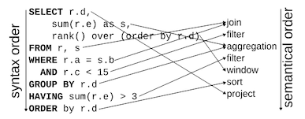
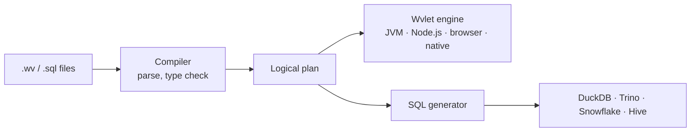

# Introduction

Wvlet (pronounced as weave-let) is a flow-style query language with its own columnar query engine. Queries start from a table and pipe it through operators in the order data flows. You choose where they run:

- **The Wvlet engine**, in-process on the JVM, Node.js, web browsers, or as a native binary. It is the default of `wvlet run` and the `wvlet` shell (REPL), and reads Parquet, Iceberg, JSON, and CSV files with no database to set up. See [Wvlet Engine](./engines/wvlet-engine.md).
- **SQL engines**: Wvlet compiles the same query to the SQL dialect of [DuckDB](./engines/duckdb.md), [Trino](./engines/trino.md), [Snowflake](./engines/snowflake.md), or Hive, so it can run where your data already lives.

Wvlet reads SQL too: `.sql` files go through the same compiler as `.wv` files, and `wvlet to_wvlet` converts existing SQL into flow-style queries, so you can adopt Wvlet one query at a time. To embed Wvlet in your own application, see [Language Bindings](./bindings/).

## Documentation Overview

- [Installation](./usage/install)
- [Quick Start](./syntax/quick-start.md)
- [Query Syntax](./syntax/)
- [Wvlet Engine](./engines/wvlet-engine.md)
- [Language Bindings](./bindings/)
- [VS Code Extension](./usage/vscode.md)
- [Development](./development/build.md)

## Why Wvlet?

Wvlet queries (saved as .wv files) provide an intuitive way to describe data processing pipelines. The Wvlet engine runs them directly, or the compiler turns them into SQL query sequences for a SQL engine.

### Traditional SQL Limitations

SQL's syntax often does not match the semantic order of data processing. Here is an example cited from _[A Critique of Modern SQL And A Proposal Towards A Simple and Expressive Query Language (CIDR '24)](https://www.cidrdb.org/cidr2024/papers/p48-neumann.pdf)_:

<center>

</center>


In SQL, the syntactic order of `SELECT ...` statements does not align with the actual data flow inside SQL engines.

Wvlet addresses this problem by starting queries with `from ...` (table scan statement), and then streamlining results through subsequent processing operators like `where`, `group by`, and `select`. This approach resembles passing table values through [a UNIX pipe](https://en.wikipedia.org/wiki/Pipeline_(Unix)):

```wvlet
-- Starts from table scan
from (table name)
where column = 'filtering condition'
...
where (more filtering conditions)
-- Grouping records by keys
group by key1, key2, ...
-- HAVING clause after group by
where (conditions for groups)
-- Specify columns to output
select c1, c2, ...
order by (ordering columns...)
```
This flow-style syntax allows for creating complex queries in a natural order and adding operators for testing or debugging data in the middle of the query. Google's SQL has also adopted this flow-style by introducing the pipe syntax to simplify writing SQL queries: _[SQL Has Problems. We Can Fix Them: Pipe Syntax In SQL (VLDB 2024)](https://research.google/pubs/sql-has-problems-we-can-fix-them-pipe-syntax-in-sql/)_.

### Modern SQL Challenges

The SQL standard (e.g., SQL-92) lacks essential features for managing multiple queries, such as:
- Reusing and generating queries
- Multi-query optimization, like incremental processing and pipeline execution
- Debugging or testing capabilities

SQL was not designed for today's complex data analytics needs. Wvlet modernizes the [50-year-old SQL](https://dl.acm.org/doi/10.1145/3649887), making it more intuitive and functional while incorporating software engineering best practices.

For more on Wvlet's motivation and design, see the presentation slides at Trino Summit 2024:

<center>
<iframe class="speakerdeck-iframe" frameborder="0" src="https://speakerdeck.com/player/4148a46ee4f24fb0816d1207439cbd33" title="Wvlet: A New Flow-Style Query Language For Functional Data Modeling and Interactive Data Analysis - Trino Summit 2024" allowfullscreen="true" ></iframe>
</center>

### One Size Doesn't Fit All

No single engine fits every workload. An in-process columnar engine suits local files and applications, a GPU suits heavy joins and aggregations, and a warehouse suits data that already lives there. Wvlet keeps one language across these choices, so each workload can run where it runs best:

- The Wvlet engine runs multi-threaded on the JVM and as a native binary, and the same engine compiled to JavaScript runs in Node.js and in the browser; the [playground](./usage/playground.md) runs queries in your browser with no server.
- An experimental GPU backend offloads joins and aggregations to NVIDIA GPUs (cudf), and falls back to the CPU for what the device can't run.
- For data in a warehouse, the compiler generates SQL for DuckDB, Trino, Snowflake, or Hive.

## Architecture

The Wvlet compiler parses `.wv` and `.sql` files, resolves names and types against the catalog and the [standard library](./syntax/stdlib.md), and produces a logical plan. The plan then either runs on the Wvlet engine or becomes SQL for a SQL engine. You can specify the directory to scan for .wv files with the `-w (workdir)` option.



- __Logical Plan__: Represents relational operators (e.g., scan, filter, projection) in a tree structure.
- __Wvlet Engine__: Optimizes the logical plan and executes it on columnar data in the same process.
- __SQL Generator__: Turns the logical plan into SQL statements in the target engine's dialect.
- [__Standard Library__](./syntax/stdlib.md): Provides common data type definitions with convenient operators while handling differences between SQL dialects.

## Features

The examples below query the TPC-H tables that every Wvlet engine session can read as `tpch.tiny.<table>` (see the [Quick Start](./syntax/quick-start.md)), and show results from the Wvlet engine.

### Flow-Style Query

Wvlet queries are written in a flow-style, allowing for a natural description of data processing pipelines. For more details, see the following documents:

- [Query Syntax](./syntax)
- [Design Philosophy](./development/design)

Example Wvlet Query:
```wvlet
-- Starting with table scan
from tpch.tiny.lineitem
-- Filtering rows
where l_shipdate >= '1994-01-01'::date
-- Apply further filtering
where l_shipdate < '1995-01-01'::date
-- Grouping rows
group by l_shipmode
-- Processing grouped rows
agg _.count as cnt

┌────────────┬──────┐
│ l_shipmode │ cnt  │
│   string   │ long │
├────────────┼──────┤
│ SHIP       │ 1325 │
│ AIR        │ 1313 │
│ TRUCK      │ 1314 │
│ REG AIR    │ 1315 │
│ RAIL       │ 1334 │
│ FOB        │ 1285 │
│ MAIL       │ 1250 │
├────────────┴──────┤
│ 7 rows            │
└───────────────────┘
```

#### Dual-Syntax Support: SQL and Wvlet

Wvlet supports SQL syntax for compatibility with existing SQL queries. You can write SQL queries in `.sql` files and leverage the same capabilities as Wvlet queries, including running them on the Wvlet engine. `wvlet to_wvlet` converts a SQL query into the flow-style syntax.

### Column-Level Operators

Wvlet provides column-level operators to process selected columns efficiently.

Example:
```wvlet
from tpch.tiny.lineitem
-- Add a new column
add l_quantity * l_extendedprice as revenue
-- Rename a column
rename l_shipdate as ship_date
-- Exclude a column
exclude l_comment
-- Reorder columns
shift l_orderkey, revenue, ship_date
limit 5;

┌────────────┬───────────────┬────────────┬───────────┬───────────┬──────────────┬───────>
│ l_orderkey │    revenue    │ ship_date  │ l_partkey │ l_suppkey │ l_linenumber │  l_qua>
│    long    │ decimal(30,4) │    date    │   long    │   long    │     long     │ decima>
├────────────┼───────────────┼────────────┼───────────┼───────────┼──────────────┼───────>
│          1 │  1300848.6400 │ 1995-08-09 │      1369 │        84 │            1 │       >
│          1 │  1033318.4000 │ 1995-09-11 │      1108 │        81 │            2 │       >
│          2 │     5089.4800 │ 1997-09-15 │       372 │        73 │            1 │       >
│          2 │  2869534.0800 │ 1997-09-10 │       726 │        27 │            2 │       >
│          2 │  1478184.9600 │ 1997-08-13 │       543 │        34 │            3 │       >
├────────────┴───────────────┴────────────┴───────────┴───────────┴──────────────┴───────>
│ 5 rows                                                                                 >
└────────────────────────────────────────────────────────────────────────────────────────>
```

If you write the same query in SQL, all column names must be enumerated in each query stage:

```sql
select * from
  (select l_orderkey, revenue, ship_date, l_partkey, l_suppkey, l_linenumber, l_quantity, l_extendedprice, l_discount, l_tax, l_returnflag, l_linestatus, l_commitdate, l_receiptdate, l_shipinstruct, l_shipmode from
    (select l_orderkey, l_partkey, l_suppkey, l_linenumber, l_quantity, l_extendedprice, l_discount, l_tax, l_returnflag, l_linestatus, ship_date, l_commitdate, l_receiptdate, l_shipinstruct, l_shipmode, revenue from
      (select l_orderkey, l_partkey, l_suppkey, l_linenumber, l_quantity, l_extendedprice, l_discount, l_tax, l_returnflag, l_linestatus, l_shipdate as ship_date, l_commitdate, l_receiptdate, l_shipinstruct, l_shipmode, l_comment, revenue from
        (select *, l_quantity * l_extendedprice as revenue from lineitem))))
limit 5
```

### Chaining Function Calls

Wvlet supports dot-notation for chaining function calls.

Example:
```wvlet
from tpch.tiny.lineitem
group by l_shipmode
agg _.count, l_quantity.sum.round(0);

┌────────────┬──────────────┬──────────────────────────┐
│ l_shipmode │ count_star() │ round(sum(l_quantity),0) │
│   string   │     long     │      decimal(38,0)       │
├────────────┼──────────────┼──────────────────────────┤
│ FOB        │         8601 │                   217830 │
│ REG AIR    │         8648 │                   218602 │
│ SHIP       │         8648 │                   220957 │
│ TRUCK      │         8570 │                   217851 │
│ RAIL       │         8592 │                   219992 │
│ AIR        │         8632 │                   221346 │
│ MAIL       │         8569 │                   218011 │
├────────────┴──────────────┴──────────────────────────┤
│ 7 rows                                               │
└──────────────────────────────────────────────────────┘
```

In SQL, every function call needs to be nested with parentheses, which require more cursor and eye movements to write the query:
```sql
-- You need to wrap each function call with parentheses (More cursor movements!)
select l_shipmode, count(*), round(sum(l_quantity), 0)
from lineitem
group by l_shipmode
```

### Functional Data Modeling

Define reusable data models that take parameters. See [Data Models](./syntax/data-models.md) for models, functions, and table declarations.

Example: 
```wvlet
model lookup(person_id: int) = {
  from persons
  where id = ${person_id}
}
```

Calling this model:
```wvlet
from lookup(1)

-- In the compiled SQL, ${person_id} will be replaced with the given input 1:
select * from persons
where id = 1
```

Composing the model with another table:
```wvlet
from lookup(1) as p
join address_table 
  on p.id = address_table.person_id
```

### Flow Orchestration (Experimental)

Organize queries into data pipelines with `flow` and `stage` constructs, including retries, timeouts, scheduling, sensors, and failure notifications:

```wvlet
flow daily_report with {
  schedule: cron('0 2 * * *')  -- 2 AM daily
  concurrency: 1
} = {
  stage extract = from raw_events | where event_date = current_date
  stage load = from extract | append to daily_summary
  stage fallback if extract.failed = from backup_events | append to daily_summary
}
```

Flow orchestration is experimental — see [Flow & Stage Syntax](./syntax/flow) for details, and share syntax feedback on [this tracking issue](https://github.com/wvlet/wvlet/issues/2021).

### Managing Queries As A Reusable Module

Queries saved as `.wv` files in a local folder work as a module. Models defined in one file can be referenced from other files in the same folder, and `package` / `import` organize them into namespaces:

```wvlet
-- lib/persons.wv
package example

model adults = {
  from persons
  where age >= 18
}
```

```wvlet
-- report.wv
import example.*

from adults
```

Mark models with `with { materialized: 'table' }` and run `wvlet build` to persist them in dependency order, like a dbt project. See [Model Pipelines](./syntax/model-pipelines).

Modules resolve from the local project folder. To share models across projects, such as one pipeline template run for many tenants, keep the shared `.wv` files in the same repository or vendor them in (a copy or a git submodule), and pass per-tenant settings as model parameters.

### Incremental Processing

:::warning
Incremental processing feature is planned to be available in 2027.
:::

Build reproducible data processing pipelines with incremental processing. 

Example:
```wvlet
@config(watermark_column='time', window_size='1h')
model weblog_records = {
  from upstream_web_records
  select time, user_id, path,
}

-- Subscribe newly inserted records in weblog_records
-- and save filtered records to downstream_web_records
from weblog_records.subscribe()
where user_id is not null
append to downstream_web_records
```

This query compiles into SQL to update the downstream_web_records table:
```sql
create table if not exists as downstream_web_records;

insert into downstream_web_records
select time, user_id, path from upstrem_weblog_records
where
  -- incremental processing
  time > ${last_watermark}
  and time <= ${last_watermark} + interval '1 hour'
  -- the original filter to the subscribed data
  and user_id is not null;
```

If supported, modern table formats like Iceberg and DuckLake are used for optimized processing.
