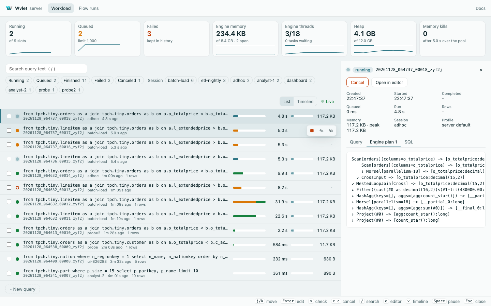

# Web UI (wvlet server)

`wvlet server` starts the wvlet server, which runs queries for [remote clients](remote-server.md) and serves a web UI on `http://localhost:9090` for writing and running Wvlet queries. Add `--open` to open it in a browser (macOS). The server's [monitoring API](remote-server.md#monitoring-api) lists running, queued, and recent queries with their plans and memory, and reports the server's load.

To start it with a sample TPC-H dataset, add `--tpch`. It sets `prepareTPCH` on the profile's connector: the in-process engine generates the tables in memory (see [TPC-H tables](../engines/wvlet-engine-tables.md#tpc-h-tables)), and a DuckDB profile runs DuckDB's `dbgen`:

```bash
$ wvlet server --tpch --open
```



## Workload console

The UI is one screen that refreshes every second:

- **Health strip**: running queries against the slots, the queue, failed queries, engine memory against the pool, busy engine threads, heap, and low-memory kills, each with a line of its last two minutes. Click Running, Queued, or Failed to show only those queries.
- **Query list**: newest first, with filter chips counted per status, session, and profile, and a search over the query text. Each row shows its status, query, id, session, age, a time bar (amber: queued, then running), and a memory bar relative to the largest query in view. Hover a row to cancel it, open it in the editor, or copy its id; check rows to cancel several at once. **Timeline** shows the same queries as bars, one lane per session.
- **Inspector**: click a row to see its timing, memory, errors, query text, engine plan, and generated SQL beside the list. The URL (`#/q/<query id>`) links to it.
- **Editor**: **New query** (or `e`) opens a Wvlet editor below the list. Runs show up in the list, and their results appear next to the editor. The editor's runs share a session id per browser tab, so a `use` statement affects only that tab.
- **Flow runs**: the second tab lists [flow](../syntax/flow.md) runs.

With `--auth-token`, the UI asks for the token once and keeps it until the browser tab closes.

## Usage

```bash
$ wvlet server --help
usage: server
  Start the wvlet server and its web UI

[global options]
 -h, --help             Display help message
 --debug                Enable debug log
 -l [LOGLEVEL]          log level
 -L [LOGLEVELPATTERNS]  log level for a class pattern
[options]
 -p, --port:[PORT]    Web UI server port. default:9090
 -w [WORKDIR]         Working directory
 --profile:[PROFILE]  Profile to use
 --catalog:[CATALOG]  Context database catalog to use
 --schema:[SCHEMA]    Context database schema to use
 --open               Open the web UI in a browser (macOS)
 --quit-immediately   Quit the server immediately after starting. Only for boot testing
 --tpch               Load small demo TPC-H tables (scale factor 0.01, or tpchScaleFactor)
 --auth-token:[AUTHTOKEN]  Require this bearer token on RPC requests
 --max-running-queries:[MAXRUNNINGQUERIES]  Queries running at once; others wait in the queue. default: half the CPUs
 --max-queued-queries:[MAXQUEUEDQUERIES]  Queries waiting to run; submissions past it are rejected. default:1000
 --max-query-memory:[MAXQUERYMEMORY]  Memory one wvlet-engine query may hold (e.g. 2GB) before it fails. default: no limit
 --memory-pool-size:[MEMORYPOOLSIZE]  Memory wvlet-engine queries may hold together (e.g. 8GB) before queued queries wait. default: 70% of the heap
 --low-memory-killer-delay:[LOWMEMORYKILLERDELAY]  How long wvlet-engine queries may stay over the memory pool size before the largest one fails (e.g. 10s, or off). default: 5s
```

`wvlet ui` was removed; use `wvlet server --open`.

## Shortcut Keys

In the console:

- `j` / `k` (or arrow keys): select the next or previous query
- `Enter`: open the selected query in the editor
- `x`: check the selected query
- `c` `c`: cancel the selected query (press twice)
- `/`: search the query text
- `e`: show or hide the editor
- `v`: switch between the list and the timeline
- `Space`: pause or resume live updates
- `Esc`: close the inspector, or clear the checked queries

In the editor:

- `⌘-enter` (`ctrl-enter` on Windows and Linux): run the selected text, or the whole editor when nothing is selected
- `⌘-shift-enter` (`ctrl-shift-enter`): run the statement at the cursor
